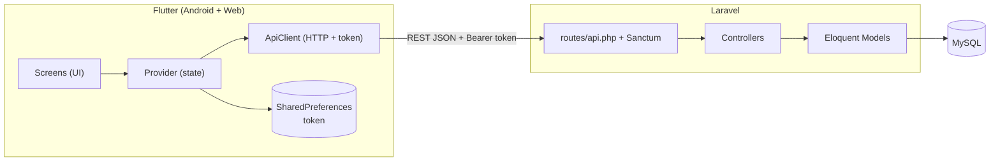

# Rancangan Solusi SIAKAD Multi-Platform (bahan UTS PBP 2)

> Draf awal. Sesuaikan dengan kondisi kelompok, lalu pastikan semua anggota bisa menjelaskan setiap keputusan (syarat UTS).

## 1. Analisis Permasalahan
- **Masalah**: informasi akademik (jadwal, KRS, nilai) tersebar / dikelola manual sehingga mahasiswa harus datang ke kampus atau mengandalkan pengumuman terpisah.
- **Pengguna**: mahasiswa (utama) dan dosen (input nilai). Pengembangan berikutnya: admin akademik.
- **Tujuan**: mahasiswa dapat melihat jadwal, mengisi KRS dengan validasi otomatis, dan melihat nilai/IPK dari HP maupun browser.
- **Ruang lingkup tahap ini**: login, jadwal, KRS, nilai (mahasiswa); daftar kelas dan input nilai (dosen). **Di luar lingkup**: manajemen data oleh admin, pembayaran, presensi, notifikasi.

## 2. Kebutuhan Sistem
**Fungsional (prioritas)**
| ID | Kebutuhan | Prioritas |
|---|---|---|
| F1 | Login/logout dengan NIM + password | Tinggi |
| F2 | Lihat jadwal kuliah per hari | Tinggi |
| F3 | Ambil/batal kelas pada KRS | Tinggi |
| F4 | Validasi KRS: duplikat, maks 24 SKS, bentrok jam, kuota | Tinggi |
| F5 | Lihat nilai & IPK | Sedang |
| F6 | Dosen melihat kelas yang diampu dan menginput/mengubah nilai peserta | Sedang |
| F7 | Pembatasan akses berdasarkan peran (dosen hanya menilai kelas miliknya) | Tinggi |
| F8 | Presensi: dosen membuka sesi berkode 6 angka, mahasiswa mengisi kode; sesi memiliki batas waktu | Sedang |
| F9 | Dosen melihat rekap kehadiran per pertemuan | Sedang |
| F10 | Manajemen data oleh admin | Rendah (tahap lanjut) |

**Nonfungsional**: keamanan (token Bearer, password di-hash, HTTPS saat produksi), kinerja (respons API < 2 dtk, timeout klien 15 dtk), kegunaan (UI responsif HP & web), keterpeliharaan (layer terpisah, REST API tunggal), kompatibilitas (Android & Web dari satu basis kode).

**Skenario utama**: Mahasiswa login → buka KRS → ambil kelas → sistem memvalidasi → kelas muncul di Jadwal → di akhir semester membuka Nilai.

## 3. Rancangan Solusi Multi-Platform
| Platform | Karakteristik | Strategi UI |
|---|---|---|
| Android | Layar sempit, sentuh | `NavigationBar` bawah, daftar kartu |
| Web | Layar lebar, mouse | `NavigationRail` samping, konten dibatasi lebar 900 px |

Satu basis kode Flutter; perubahan layout ditentukan lebar layar (≥ 720 px = adaptif ke rail).
Layar: Login, Jadwal, KRS, Nilai. (Lampirkan screenshot/wireframe di slide.)

## 4. Arsitektur Sistem

- **Layer klien**: Screens → Providers → ApiClient. UI tidak memanggil HTTP langsung.
- **State**: `provider` (ChangeNotifier): `AuthProvider` (sesi), `SiakadProvider` (jadwal/KRS/nilai).
- **Penyimpanan**: data akademik di MySQL (sumber kebenaran); klien hanya menyimpan token login.
- **Integrasi**: REST/JSON; autentikasi Laravel Sanctum (token pribadi) di header `Authorization: Bearer`.
- **Aturan bisnis KRS** ada di server (bukan di Flutter) agar konsisten di semua platform dan tidak bisa dilewati.
- **Otorisasi berbasis peran**: kolom `users.role` (`mahasiswa`/`dosen`). Server memeriksa peran di setiap endpoint dosen dan memastikan `jadwals.dosen_id` = akun yang login sebelum nilai disimpan. Flutter hanya memilih tampilan (`HomeShell` vs `DosenHome`) berdasarkan peran; pengamanan sebenarnya tetap di server.

**Alur contoh – ambil kelas**: tombol "Ambil" → `SiakadProvider.ambil()` → `POST /api/krs` → `KrsController@store` memvalidasi 4 aturan → 201 / 422 + pesan → provider memuat ulang data → UI diperbarui.

**Skema basis data**: `users`(role) 1–1 `mahasiswas`; `users`(dosen) 1–n `jadwals` (kolom `dosen_id`); `mata_kuliahs` 1–n `jadwals`; `mahasiswas` n–n `jadwals` lewat `krs`; `krs` 1–1 `nilais`; `jadwals` 1–n `presensi_sesis` (satu pertemuan, berisi kode dan batas waktu); `presensi_sesis` n–n `krs` lewat `presensis` (satu baris = satu mahasiswa hadir).

**Alur presensi**: dosen `POST /api/dosen/kelas/{id}/presensi` → server membuat kode 6 angka unik di antara sesi aktif dan menetapkan `berlaku_sampai` → dosen membagikan kode → mahasiswa `POST /api/presensi {kode}` → server memastikan kode cocok dengan sesi yang masih berlaku **pada kelas yang diambil mahasiswa itu** dan belum pernah diisi → baris `presensis` dibuat. Validasi waktu memakai jam server (bukan jam perangkat) agar tidak bisa dimanipulasi, dan endpoint dibatasi 10 percobaan per menit supaya kode 6 angka tidak bisa ditebak beruntun.

## 5. Pemilihan Teknologi & Alasan
| Teknologi | Alasan |
|---|---|
| Flutter/Dart | Satu kode untuk Android & Web (syarat multi-platform); widget adaptif |
| provider | Sederhana, resmi direkomendasikan, cukup untuk skala aplikasi; lebih mudah dipahami pemula dibanding BLoC/Riverpod |
| http | Ringan untuk REST sederhana; cukup tanpa interceptor rumit |
| shared_preferences | Menyimpan token ringan & jalan di web. *Trade-off*: kurang aman dibanding `flutter_secure_storage` di perangkat; pertimbangan peningkatan |
| Laravel + Sanctum | Ekosistem PHP umum di kampus, migrasi/ORM cepat, token API bawaan |
| MySQL | Data relasional (KRS = relasi antartabel), mudah di XAMPP/Laragon |

## 6. Rencana Implementasi
- **Struktur**: `lib/{core,models,providers,screens}`; backend `Controllers/Api`, `Models`, `migrations`, `seeders`.
- **Modul**: Auth → Jadwal → KRS → Nilai.
- **Tahapan**: (1) analisis & desain, (2) backend + seeder, (3) klien Flutter, (4) pengujian & perbaikan, (5) fitur dosen/admin.
- **Progres**: *(isi sesuai kenyataan — mis. API & UI dasar selesai, belum diuji di perangkat)*.
- **Kendala & rencana**: koneksi emulator ke localhost (`10.0.2.2`), HTTP cleartext di Android (pakai HTTPS saat produksi), peran dosen/admin belum ada, tahun ajaran masih konstanta (pindah ke tabel pengaturan).
